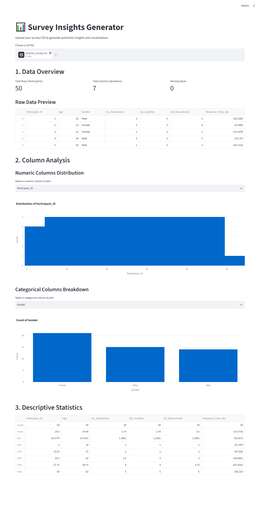

# Survey Insights Generator



Interactive dashboard to automatically generate statistical insights and publication-ready visualizations from survey data (CSV).

## Why This Exists

Researchers spend hours cleaning data and manually creating charts for papers. This tool automates the exploratory data analysis (EDA) phase, turning raw CSVs into actionable insights instantly.

## Features

-  **Automatic Demographics Breakdown**: Visualize participant distribution.
- ⏱️ **Response Time Analysis**: Identify speeders and outliers.
- 📈 **Likert Scale Visualizations**: Diverging bar charts for survey questions.
- 📥 **One-Click Export**: Download cleaned datasets and summary tables.

## Quick Start

```bash
pip install -r requirements.txt
streamlit run src/app.py
